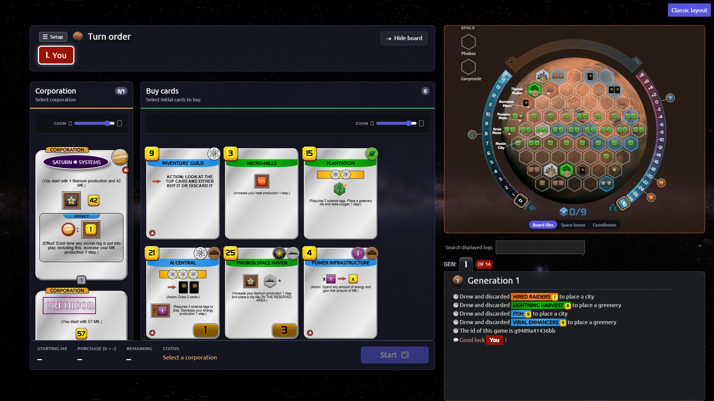
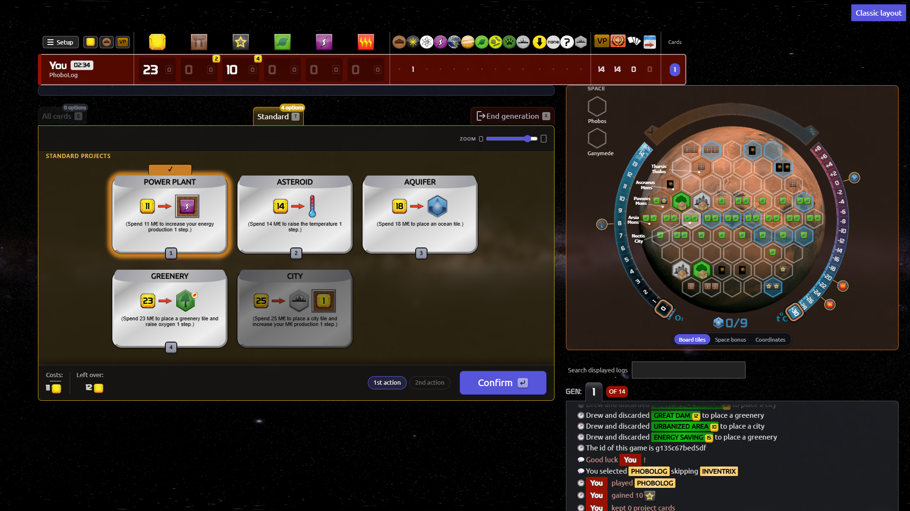
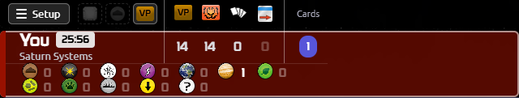
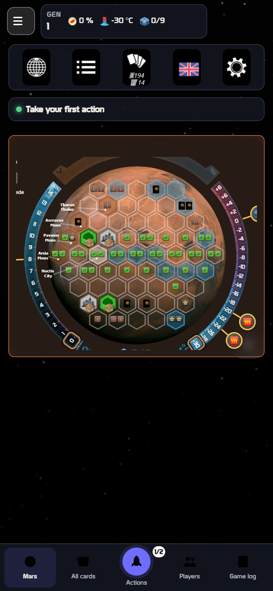

# Wrybit interface guide

Скриншоты сняты в чистом браузерном профиле **без расширения-адвайзора** и без остальных расширений.

## Desktop: один экран без прокрутки страницы

На широком экране игровое поле, игроки и панель действий занимают окно целиком:

- страница не прокручивается;
- длинные списки карт, лог и выбор стартовых карт прокручиваются **внутри своих панелей**;
- кнопка **Start** / **Confirm** остаётся в нижней панели действий.

Если нужно больше места для действий:

1. Нажмите **Hide board** над полем.
2. Или потяните разделитель между левой и правой колонками.
3. Высоту блока игроков можно менять ручкой под таблицей игроков.
4. Размер карт меняется ползунком **ZOOM** над списком карт.

## Панель игроков

Когда таблица не помещается по ширине, она больше не оставляет одни голые цифры ресурсов:

- VP, TR, карты и доступные действия остаются на месте;
- ресурсные колонки сворачиваются первыми;
- сыгранные теги показываются отдельной строкой иконок под игроком, с количеством;
- на широком экране теги остаются обычными колонками.

Это не полный возврат к старой панели, но возвращает главный недостающий слой — сыгранные метки.

## Значки и spectator

- Базовые тайлы океана, города и зелени используют классическую игровую графику, а не мелкие символы.
- В спектаторе обновление лога больше не пересоздаёт весь игровой экран: новые строки добавляются на месте и мягко проявляются; позиция скролла сохраняется.
- Специальные тайлы без собственной графики (например, Harbor Borealis, Invak City, Suburbs) пока остаются с временными значками — если на поле попался такой тайл, это отдельная задача по ассетам.

## Клавиатура

Основные сочетания:

| Клавиша | Действие |
|---|---|
| **Q** | карты в руке |
| **W** | действия |
| **E** | проекты |
| **R** | награды и вехи |
| **T** | стандартные проекты |
| **Z** | пас |
| **X** | завершить поколение |
| **1…9** | выбрать карту/опцию с этим номером |
| **Enter** | подтвердить текущий шаг |
| **Space** | продолжить обычный шаг |
| **Esc** | отменить/закрыть |
| **Ctrl+Z** | отменить последнее действие |
| **,** / **.** | предыдущая/следующая вкладка |
| **?** | полный список горячих клавиш |

Полный список открывается по **?**, а также через **Player help → Hot Keys**.
В игре добавлена вкладка **Player help → Interface & Controls**: она повторяет эту инструкцию и объясняет изменение размеров.

## Мобильный экран

- Вкладки **Mars**, **All cards**, **Actions**, **Players**, **Game log** находятся внизу.
- Карточки, поле и выбор сумм делаются касанием; клавиатура не обязательна.
- Для широкого поля поверните телефон в ландшафтную ориентацию.
- Верхняя панель содержит меню, параметры, колоду и настройки; переключатель **Classic layout** на телефоне скрыт, чтобы не перекрывать шапку.

## Проверка

Запустить клиентские тесты Wrybit и проверку типов:

    npx vitest run tests/client/wrybit --reporter=dot
    npx vue-tsc --noEmit -p tsconfig.vue-tsc.json

Проверено в браузере на **1920×1080** и **390×844**:

- desktop player: scrollHeight равен innerHeight;
- mobile player: ширина документа равна ширине окна, горизонтальной прокрутки страницы нет;
- вкладка **Interface & Controls** открывается без ошибок консоли.

## Осталось проверить

- реальные партии с 3–5 игроками и всеми дополнениями;
- поведение при 125% / 150% масштабе браузера;
- iPhone Safari и Android Chrome на физических устройствах.
